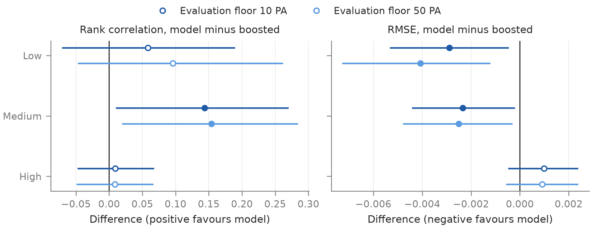

# Hitter Embedding

**Conditional queries against a learned hitter process model.** A small PyTorch model learns a
64-dimensional embedding for each MLB hitter from Statcast pitches. You can then ask it how a
hitter projects against a chosen set of pitchers (a handedness split, a staff, a pitcher type)
without retraining.

**[▶ Open the interactive matchup explorer](https://nseluga.github.io/Hitter-Embedding/)** ·
[Results](#results) · [Reproduce](#reproduce) · [Citation](#citation)

[](https://nseluga.github.io/Hitter-Embedding/)

---

## Summary

Bench and platoon decisions turn on splits, and splits are exactly where data is thin: about 226
PA vs left-handed pitchers before half the variance in a hitter's wOBA is skill. This model
learns from what the hitter controls on each pitch: swing decision, contact, exit velocity,
launch angle and spray direction. It does not use the noisy end-of-plate-appearance outcome.
It was trained on 6.5M Statcast pitches (2015–2024) covering 1,672 hitters, and is inspired by
(batter|pitcher)2vec (Alcorn 2018). A query reweights the pitchers that per-pitch predictions
are averaged over. The weighted predictions then pass through the count-state Markov chain to
give a projected wOBA. A new split needs a new weight vector, not a new model.

<p align="center"></p>
<p align="center"><sub>2025 test, hitters seen in training only: model minus gradient-boosted baseline by prior-exposure stratum, with 95% intervals.</sub></p>

## Results

Sealed 2025 test season, wOBA vs LHP and vs RHP. The 2025 season was used once, after model
selection on 2024.

| Model | Pooled RMSE ↓ | Pooled rank corr ↑ |
|---|---|---|
| **Hitter embedding (5-seed ensemble)** | **0.0433** | **0.50** |
| Gradient-boosted trees (XGBoost) | 0.0438 | 0.44 |
| Empirical Bayes shrinkage | 0.0444 | 0.42 |

- RMSE is tied with the baselines. Ranking is better: the model orders hitters within a split
  better than it sizes the split.
- It beats both baselines on both measures only for hitters with 113–451 prior PA. This result is exploratory.
- Below 113 prior PA, its error is lower than both baselines. Its ranking margin over XGBoost is
  within noise.
- Hitters with no training-season pitches have no embedding and are not scored.
- With no labels, the embedding separates hitters on power and contact. Held-out probe accuracy
  is 0.79 and 0.75, against 0.33 by chance.

Training and validation loss curves for every tuned arm are in
[`results/loss_curves/`](results/loss_curves/). Per-epoch metrics for all runs are in
`all_runs.csv`, and the final model's 2025 test loss is in `final_test_loss.csv`.

## Matchup explorer

**https://nseluga.github.io/Hitter-Embedding/** lets you pick any hitter and any pitcher and see
the final model's projected wOBA. The final model (`clean_dim64_final`) is trained on 2015–2024
and queried on 2025 matchups. Pitcher traits come only from the training seasons. The explorer
is **descriptive only**: one season cannot validate hitter-by-pitcher effects, so read every cell
as a hypothesis. The source is in [`explorer/`](explorer/). It deploys on every push to `main`
that touches `explorer/**`.

## Repository layout

```
src/
  data/       Statcast pull (frozen dated snapshots), cleaning, labels, eval targets
  features/   pitch context features
  model/      model (v1.py), training, sweeps, query composition (query.py)
  analysis/   evaluation, baselines, figures, explorer export
  config/     frozen walk-forward split and wOBA weights
notebooks/    01–09, profiling through model visualization, read in order
results/      tracked evaluation outputs and figures (checkpoints are not tracked)
scripts/      overnight pipeline drivers (overnight.sh, night*.sh)
explorer/     static matchup explorer (GitHub Pages)
tests/        pytest suite
```

## Setup

Python 3.13 on CPU. The model has <1M parameters, so no GPU is needed.

```bash
python -m venv .venv && source .venv/bin/activate
pip install -r requirements.txt
```

`mlflow-skinny` is used on purpose. The full `mlflow` package would downgrade pandas 3.

## Reproduce

Each step is a module run from the repo root with `PYTHONPATH=.`. Training metrics go to a local
MLflow file store (`mlruns/`). Everything that gets reviewed lands in `results/`.

1. **Data.** `python -m src.data.pull_statcast` writes a dated, immutable snapshot under
   `data/raw/statcast/`. Statcast revises old data, so the snapshot date is part of the result.
2. **Tensors.** `python -m src.data.model_dataset --out-dir data/processed/phase_d5_clean` builds
   the training tensors. The split is frozen in `src/config/split_config.json`: train 2015–2023,
   validate 2024, test 2025.
3. **Tuning.** `python -m src.model.sweep --stage clean` runs the arm screen. `scripts/night1_*`
   through `night3_*` show the exact sequence: screen, 5-seed deepen, replay gate.
4. **Refit and test.** `scripts/night4_refit_2025.sh` refits the winner on 2015–2024.
   `night4b_2025_chain.sh` spends the sealed 2025 season.
5. **Loss curves.** `python -m src.analysis.loss_curves` writes the curves from `mlruns/`, and
   `python -m src.analysis.final_loss_report` writes the 2025 test loss.
6. **Explorer.** First run
   `python -m src.analysis.pitcher_type_query --stage ceiling --eval-season 2025 --train-seasons 2015 … 2024 --out-dir results/pitcher_type_query_2025`,
   then the same command with `--stage query --arm clean_dim64_final --data-dir data/processed/phase_d5_clean_final --hitter-stats results/model_visualization_final_clean/hitter_stats.csv`.
   Finally run `python -m src.analysis.matchup_explorer_data`.

Tests: `pytest -q`. Some tests skip when the gitignored data or checkpoints are absent.

## Limitations

- Hitters with no pitches in the training seasons get no embedding. The paper does not score
  them. The explorer shows them through a per-batting-side cold-start prior embedding.
- The model ranks better than it calibrates the size of a split. Use it to order platoon options,
  not as a replacement for a projection system.
- Matchup effects below the handedness level (pitcher type, single pitcher) are not validated.
  One-season reliability of those contrasts is about 0 (`results/pitcher_type_query/ceiling.csv`).
- The training data and checkpoints are not in git (size). Re-pull with step 1.

## Citation

```bibtex
@misc{seluga2026hitterembedding,
  title  = {Conditional Queries Against a Learned Hitter Process Model},
  author = {Seluga, Nate},
  year   = {2026},
  url    = {https://github.com/nseluga/Hitter-Embedding}
}
```

Data: [Baseball Savant / Statcast](https://baseballsavant.mlb.com), via
[pybaseball](https://github.com/jldbc/pybaseball). Method inspired by Alcorn,
*(batter|pitcher)2vec* (MIT Sloan SAC 2018).
